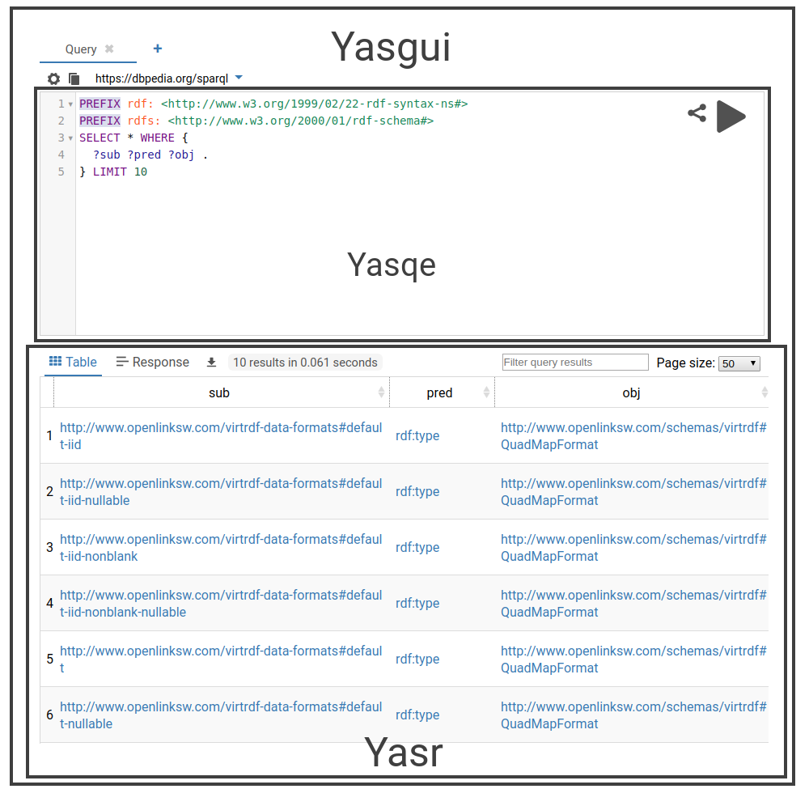

# Yasgui API Reference

Yasgui consists of three components: Yasqe (a SPARQL Query Editor), Yasr (a SPARQL result visualizer), and Yasgui which binds the former together.
Here you can find documentation on ways to include, configure and extend these components as suitable to your use-case.

.

## About additional plugins <!-- {#triplyDbPlugins} -->

Yasgui, Yasqe and Yasr are all [open source](https://github.com/TriplyDB/Yasgui) and MIT licensed.
Triply provides additional plugins that are only free to use via [https://yasgui.triply.cc](https://yasgui.triply.cc) or [TriplyDB](https://triplydb.com/). These additional plugins are not MIT licensed and cannot be used or included programmatically.

## Installation

### Via package managers

To include Yasgui in a project include the package run the commands below.

#### npm

```sh
npm i @triply/yasgui
```

#### yarn

```sh
yarn add @triply/yasgui
```

### Via cdn

To include Yasgui in your webpage, all that's needed is importing the Yasgui JavaScript and CSS files, and initializing a Yasgui object:

```html
<head>
  <link href="https://unpkg.com/@triply/yasgui/build/yasgui.min.css" rel="stylesheet" type="text/css" />
  <script src="https://unpkg.com/@triply/yasgui/build/yasgui.min.js"></script>
</head>
<body>
  <div id="yasgui"></div>
  <script>
    const yasgui = new Yasgui(document.getElementById("yasgui"));
  </script>
</body>
```

If you only want to use Yasgui for querying a specific endpoint, you can add the following styling to disable the endpoint selector:

```html
<style>
  .yasgui .autocompleteWrapper {
    display: none !important;
  }
</style>
```

And pass a second argument to the Yasgui initializer to specify the default endpoint:

```js
const yasgui = new Yasgui(document.getElementById("yasgui"), {
  requestConfig: { endpoint: "http://example.com/sparql" },
  copyEndpointOnNewTab: false,
});
```

Note: If you've already opened the Yasgui page before, you must first clear your local-storage cache before you will see the changes taking effect.

## API Reference

### Yasgui API

Yasgui features tabs. Each tab has its own isolated query and results.
These are persistent as the user switches between tabs.

```js
// Add a new Tab. Returns the new Tab object.
yasgui.addTab(
  true, // set as active tab
  { ...Yasgui.Tab.getDefaults(), name: "my new tab" }
);

// Get a Tab. Returns the current Tab if no tab id is given.
yasgui.getTab("tab_id_x");
```

### Tab API

```js
// set the query of the tab
tab.setQuery("select * where {...}");

// close the tab
tab.close();

// access the Yasqe API for the tab
tab.yasqe;

// access the Yasr API for the tab
tab.yasr;
```

### Events

Yasgui emits several Events. For information on how to use Events, see [NodeJS's Event documentation](https://nodejs.org/api/events.html).

```ts
// Fires when a query is executed
yasgui.on("query", (instance: Yasgui, tab: Tab) => {});
// Fires when a query is finished
yasgui.on("queryResponse", (instance: Yasgui, tab: tab) => {});
```

### Configuration <!-- {#yasgui-config} -->

This configuration object is accessible/changeable via `Yasgui.defaults` or `yasgui.config`. You can pass these along when initializing Yasgui as well. To change settings to the Yasqe and Yasr components used by Yasgui, you are best off changing the `Yasgui.Yasqe.defaults` and `Yasgui.Yasr.defaults` objects before initializing Yasgui.

```js
{
  /**
   * Change the default request configuration, such as the headers
   * and default yasgui endpoint.
   * Define these fields as plain values, or as a getter function
   */
  requestConfig: {
    endpoint: 'https://example.org/sparql',
    //Example of using a getter function to define the headers field:
    headers: () => ({
      'key': 'value'
    }),
    method: 'POST',


  },
  // Allow resizing of the Yasqe editor
  resizeable: true,

  // Whether to autofocus on Yasqe on page load
  autofocus: true,

  // Use the default endpoint when a new tab is opened
  copyEndpointOnNewTab: false,

  // Configuring which endpoints appear in the endpoint catalogue list
  endpointCatalogueOptions {
    getData: () => {
      return [
        //List of objects should contain the endpoint field
        //Feel free to include any other fields (e.g. a description or icon
        //that you'd like to use when rendering)
        {
          endpoint: "https://dbpedia.org/sparql"
        },
        {
          endpoint: "https://query.wikidata.org"
        }
        // ...
      ];
    },
    //Data object keys that are used for filtering. The 'endpoint' key already used by default
    keys: [],
    //Data argument contains a `value` property for the matched data object
    //Source argument is the suggestion DOM element to append your rendered item to
    renderItem: (data, source) => {
        const contentDiv = document.createElement("div");
        contentDiv.innerText = data.value.endpoint;
        source.appendChild(contentDiv);
      }
  }
}
```

## Yasqe

Yasqe extends the CodeMirror Library. For an overview of CodeMirror functionality, see the [CodeMirror documentation](https://codemirror.net/doc/manual.html). Note: Where CodeMirror provides `CodeMirror` in the global namespace, we provide `Yasqe`.

### Yasqe API

The Yasqe API can be accessed via `yasqe` (if Yasqe is run standalone) or via a tab `yasgui.getTab().yasqe` when run in Yasgui

```js
// Set query value in editor
yasqe.setValue("select * where {...}");

// Get query value from editor
yasqe.getValue();

// execute a query
yasqe.query({
  url: "https://dbpedia.org/sparql",
  reqMethod: "POST", // or "GET"
  headers: { Accept: "..." /*...*/ },
  args: { arg1: "val1" /*...*/ },
  withCredentials: false,
});

// get whether we're in query or update mode
yasqe.getQueryMode();

// get the query type (select, ask, construct, ...)
yasqe.getQueryType();

// get prefixes map from the query string
yasqe.getPrefixesFromQuery();

// Add prefixes to the query.
yasqe.addPrefixes({ dbo: "http://dbpedia.org/ontology/" });

// Remove prefixes to the query.
yasqe.removePrefixes({ dbo: "http://dbpedia.org/ontology/" });

// set size of input area
yasqe.setSize(500, 300);

// Collapsing prefixes if there are any. Use false to expand them.
yasqe.collapsePrefixes(true);
```

### Events

Yasqe emits several Events. For information on how to use Events, see [NodeJS's Event documentation](https://nodejs.org/api/events.html).

```ts
// Fires when a query is executed
yasqe.on("query", (instance: Yasqe, req: superagent.SuperAgentRequest) => {});
// Fires when a query is finished
yasqe.on("queryResponse", (instance: Yasqe, req: superagent.SuperAgentRequest, duration: number) => {});
```

### Configuration <!-- {#yasqe-config} -->

The configuration options, for Yasqe can be accessed through `Yasgui.Yasqe` or `yasqe.options`.

Here are some configurable fields for Yasqe. They can be accessed and set through `Yasqe.defaults` and `yasqe.options`. The configuration object extends the [CodeMirror config](https://codemirror.net/doc/manual.html#config), meaning fields like for example `tabSize` may also be set.

```ts
// number of seconds to persist query input, stored in the browser
// set to 0 to always load the default query on page load
persistencyExpire // default: 30 days

// default settings for how to query the endpoint
requestOpts: {
  endpoint: "http://dbpedia.org/sparql",
  method: "POST",
  headers: {}
},
```

## Yasr

Yasr is an extendable library that renders SPARQL results. Yasr is responsible for gluing the different visualization plugins together, and providing utilities such as SPARQL result parsers.

### Yasr API

```ts
// Set and draw a SPARQL response. The parameter is either
// - a plain response string
// - a SuperAgent response
// - or an object with the specified keys
yasr.setResponse({
  data: "...";
  contentType: "application/sparql-results+json";
  status: 200;
  executionTime: 1000; // ms
  // error to show
})

// Draw results with current plugin
yasr.draw()

// Check whether a result has been drawn
yasr.somethingDrawn()

// Select a plugin
yasr.selectPlugin("table")

// Download a result set (if possible)
yasr.download()
```

### Events

```ts
// Fires just before a plugins draws the results
yasr.on("draw",(instance: Yasr, plugin: Plugin) => void);

// Fires when a plugin finished drawing the results
yasr.on("drawn",(instance: Yasr, plugin: Plugin) => void);
```

### Configuration <!-- {#yasr-configuration} -->

This configuration object is accessible/changeable via `Yasr.defaults` and `yasr.options`, and you can pass these along when initializing Yasr as well. Output visualizations are defined separately.

```ts
// Ordered list of enabled output plugins
pluginOrder = ["table", "response"]

// The default plugin
defaultPlugin = "table"

// seconds before results expire in the browser
// Set to 0 to disable results persistency
persistencyExpire // default: 30 days

// Map of prefixes to use in results views
prefixes: {"dbo":"http://dbpedia.org/ontology/",/*...*/}
```

### Yasr plugins

Each plugin has its own configuration options.
These options can be accessed through `Yasr.plugins`.

#### Table

This plugin shows SPARQL results as a table, using the [DataTables.net](https://datatables.net/) plugin. This plugin is defined in `Yasr.plugins.table` and can be configured using `Yasr.plugins.table.defaults`.

```ts
// Open URIs in results in a new window rather than the current.
openIriInNewWindow = true;
```

#### Raw Response

A plugin which uses [CodeMirror](https://codemirror.net/) to present the SPARQL results as-is. This plugin is defined at `Yasr.plugins.response` and can be configured using `Yasr.plugins.response.defaults`.

```ts
// Number of lines to show before hiding rest of response
// (too large value may cause browser performance issues)
maxLines = 30;
```

### Writing a Yasr plugin

To register a Yasr plugin, add it to Yasr by running `Yasr.registerPlugin(pluginName: string, plugin: Plugin)`. Below is an example implementation for rendering the result of an Ask query, which returns either `true` or `false`. See also the implementations of the [Table](https://github.com/TriplyDB/YASGUI.YASR/blob/gh-pages/src/table.js) and [Raw Response](https://github.com/TriplyDB/YASGUI.YASR/blob/gh-pages/src/rawResponse.js) plugins.

```ts
class Boolean {
  // A priority value. If multiple plugin support rendering of a result, this value is used
  // to select the correct plugin
  priority = 10;

  // Whether to show a select-button for this plugin
  hideFromSelection = true;

  constructor(yasr) {
    this.yasr = yasr;
  }

  // Draw the result set. This plugin simply draws the string 'True' or 'False'
  draw() {
    const el = document.createElement("div");
    el.textContent = this.yasr.results.getBoolean() ? "True" : "False";
    this.yasr.resultsEl.appendChild(el);
  }

  // A required function, used to indicate whether this plugin can draw the current
  // resultset from yasr
  canHandleResults() {
    return (
      this.yasr.results.getBoolean &&
      (this.yasr.results.getBoolean() === true || this.yasr.results.getBoolean() == false)
    );
  }
  // A required function, used to identify the plugin, works best with an svg
  getIcon() {
    const textIcon = document.createElement("p");
    textIcon.innerText = "✓/✗";
    return textIcon;
  }
}

//Register the plugin to Yasr
Yasr.registerPlugin("MyBooleanPlugin", Boolean);
```

## FAQ

### Using Yasgui in react

To include Yasgui in React, use the following snippet. This snippet assumes a React repository configured via [create-react-app](https://github.com/facebook/create-react-app), and a minimum React version of 16.8.

```ts
import Yasgui from "@triply/yasgui";
import "@triply/yasgui/build/yasgui.min.css";
export default function App() {
  useEffect(() => {
    const yasgui = new Yasgui(document.getElementById("yasgui"));
    return () => {};
  }, []);

  return <div id="yasgui" />;
}
```
