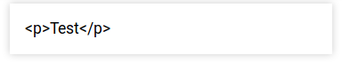
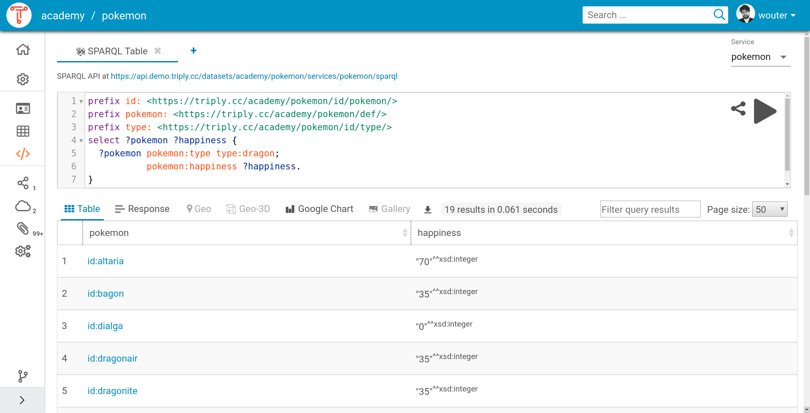
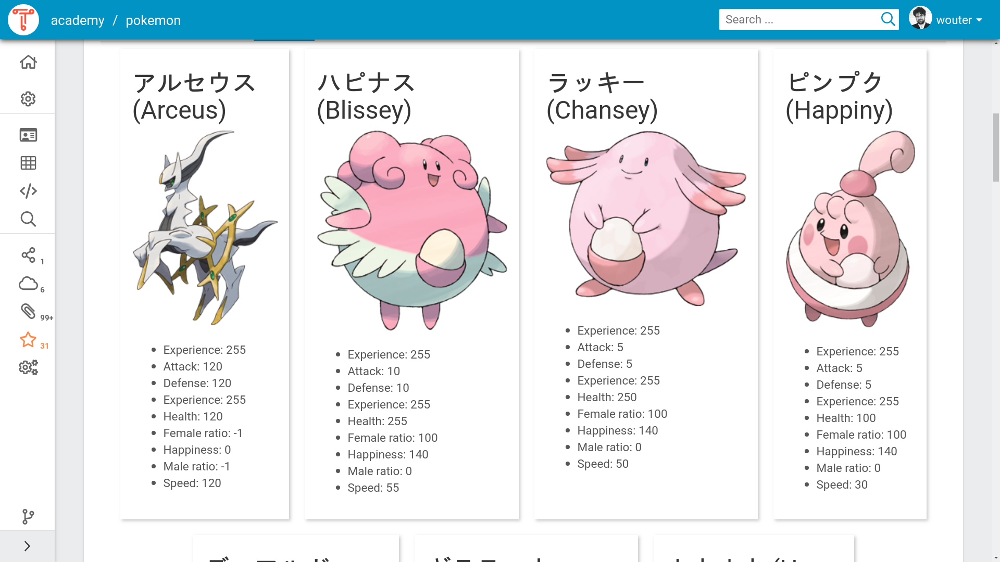

# Yasgui

This section explains the use of SPARQL via Yasgui. Yasgui provides
various advanced features for creating, sharing, and visualizing
SPARQL queries and their results.

## SPARQL Editor

The Yasgui SPARQL editor is a query editor that offers syntax highlighting, syntax validation, autocompletion, a variety of different SPARQL result visualizations, with a plugin architecture that [enables customization](../yasgui-api/index.md).

By default, the query editor provides autocomplete suggestions via the [LOV](https://lov.linkeddata.es/dataset/lov/) API.
Website maintainers can add their own autocompletion logic as well. For example, the Yasgui integration in [TriplyDB](https://triplydb.com) uses the TriplyDB API to more accurately provide suggestions based on the underlying data.

Sharing queries now involves less than having to copy/past complete SPARQL queries. Instead, you can share your query (and the corresponding visualization settings) using a simple URL.

### Supported key combinations

The following table enumerates the key combinations that are supported
by the SPARQL Editor.

| **Key combination** | **Behavior**                                                                                      |
| ------------------- | ------------------------------------------------------------------------------------------------- |
| `Alt + Left`        | Move the cursor to the beginning of the current line.                                            |
| `Alt + Right`       | Move the cursor to the end of the current line.                                                  |
| `Alt + U`           | Redo the last change within the current selection.                                               |
| `Ctrl + Backspace`  | Delete to the beginning of the group before the cursor.                                          |
| `Ctrl + Delete`     | Delete to the beginning of the group after the cursor.                                           |
| `Ctrl + End`        | Move the cursor to the end of the query.                                                         |
| `Ctrl + Home`       | Move the cursor to the start of the query.                                                       |
| `Ctrl + Left`       | Move the cursor to the left of the group before the cursor.                                      |
| `Ctrl + Right`      | Move the cursor to the right of the group the cursor.                                            |
| `Ctrl + [`          | Decrements the indentation for the current line or the lines involved in the current selection.  |
| `Ctrl + ]`          | Increments the indentation for the current line or the lines involved in the current selection.  |
| `Ctrl + /`          | Toggles on/off the commenting of the current line or the lines involved in the current selection. |
| `Ctrl + A`          | Select the whole query.                                                                          |
| `Ctrl + D`          | Deletes the current line or all lines involved in the current selection.                         |
| `Ctrl + U`          | Undo the last change within the current selection.                                               |
| `Ctrl + Y`          | Redo the last undone edit action.                                                                |
| `Ctrl + Z`          | Undo the last edit action.                                                                       |
| `Ctrl + Shift + F`  | Auto-formats the whole query or the lines involved in the current selection.                     |
| `Shift + Tab`       | Auto-indents the current line or the lines involved in the current selection.                    |
| `Tab`               | Indents the current line or the lines involved in the current selection.                         |

### Templates

SPARQL has standardized capabilities for constructing complex strings
and literals. This allows human-readable label and HTML widgets to be
generated from within SPARQL. Unfortunately, the syntax for
constructing such labels and widgets is a bit cumbersome.

#### SPARQL-concat

For example, the following SPARQL query returns HTML widgets that can
be displayed in a web browser (see [SPARQL Gallery](#gallery-triplydb-plugin)). It uses the
`concat` function which allows an arbitrary number of string arguments
to be concatenated into one string. Notice that this requires
extensive quoting for each argument (e.g., `'<h3>'`), as well as
conversions from literals to strings (e.g., `str(?typeName)`).
Finally, in order to return an HTML literal we need to first bind the
concatenated string to some variable `?lex`, and then apply the
`strdt` function in order to construct a literal with datatype IRI
`rdf:HTML`. You can [try this query
online](https://triplydb.com/academy/-/queries/sparql-html).

```sparql
prefix def: <https://triplydb.com/academy/pokemon/def/>
prefix foaf: <http://xmlns.com/foaf/0.1/>
prefix rdf: <http://www.w3.org/1999/02/22-rdf-syntax-ns#>
prefix rdfs: <http://www.w3.org/2000/01/rdf-schema#>
select * {
  ?pokemon
    def:cry ?cry;
    def:type/rdfs:label ?typeName;
    foaf:depiction ?image;
    rdfs:label ?name.
  bind(concat('<h3>',str(?typeName),' 》 ',str(?name),'</h3>',
              '',
              '<audio controls src="',str(?cry),'"></audio>') as ?lex)
  bind(strdt(?lex,rdf:HTML) as ?widget)
}
limit 25
```

#### Handlebars

The SPARQL Editor in TriplyDB supports SPARQL Templates, which makes
it easier to write human-readable labels and HTML widgets. SPARQL
Templates are strings in which occurrences of `{{x}}` will be replaced
with the to-string converted results of bindings to SPARQL variable
`?x`.

The following example query produces the same result set as the above
one, but allows the entire HTML string to be written at once as a
SPARQL Template. Notice that this removes the need for concatenating
(`concat/n`), explicit to-string conversion (`str/1`), and also allows
the HTML literal to be constructed more easily (no `strdt/2` needed).
You can [try this query online](https://triplydb.com/academy/-/queries/sparql-templating).

```sparql
prefix def: <https://triplydb.com/academy/pokemon/def/>
prefix foaf: <http://xmlns.com/foaf/0.1/>
prefix rdf: <http://www.w3.org/1999/02/22-rdf-syntax-ns#>
prefix rdfs: <http://www.w3.org/2000/01/rdf-schema#>
select * {
  ?pokemon
    def:cry ?cry;
    def:type/rdfs:label ?typeName;
    foaf:depiction ?image;
    rdfs:label ?name.
  bind('''
<h3>{{typeName}} 》 {{name}}</h3>

<audio controls src="{{cry}}"></audio>'''^^rdf:HTML as ?widget)
}
limit 25
```

SPARQL Templates can be combined with the [SPARQL Gallery](#gallery-triplydb-plugin) feature in
order to generate galleries of HTML widgets.

### Rendering HTML

To distinguish between text and `HTML` result values the visualization library checks for the `rdf:HTML` datatype.

The following query will return as plain text

```sparql
select * {
  bind('<p>Test</p>' as ?widget)
}
```



This query will render the result as `HTML`

```sparql
PREFIX rdf: <http://www.w3.org/1999/02/22-rdf-syntax-ns#>
select * {
  bind('<p>Test</p>'^^rdf:HTML as ?widget)
}
```


In order to guarantee safety, TriplyDB sanitizes HTML literals before
rendering them. This means that tags like `<embed>`, `<iframe>` and
`<script>` are sanitized away, as are attributes such as `onerror` and
`onload`.

## Visualizations

### Table

This view allows SPARQL results to be displayed in a table. Each
column in the table corresponds to a variable that belongs to the
outer projection. Each row in the table corresponds to one query
result. Each cell contains an RDF term or `NULL`.

#### Features

In addition to displaying the SPARQL result set, the SPARQL Table has
the following features:

|                   |                                                                                                                                                                                                                                                                                                                                                               |
| ----------------- | ------------------------------------------------------------------------------------------------------------------------------------------------------------------------------------------------------------------------------------------------------------------------------------------------------------------------------------------------------------- |
| **Abbreviations** | The SPARQL Table uses the prefix declarations in the SPARQL query in order to abbreviate IRIs that appear in table cells.                                                                                                                                                                                                                                    |
| **Filter**        | By entering a search string into the “Filter query results” field, the table will only display result rows in which the entered search string appears.                                                                                                                                                                                                       |
| **Indices**       | The first column in the table indicates the index of each row in the SPARQL result set.                                                                                                                                                                                                                                                                      |
| **Pagination**    | By default the Table displays at most 50 rows. This maximum value can be changed to 10, 100, 1.000, or “All”.                                                                                                                                                                                                                                                |
| **Sorting**       | A sort widget appears to the right of each header label. By pressing on the upward pointing arrow of the sort widget, rows will be sorted based on the lexicographic order of the values within the corresponding column. By pressing the downward pointing arrow of the sort widget, rows will be inversely sorted according to the same lexicographic order. |

#### Table Example

The following SPARQL query (or [see here](https://triplydb.com/academy/-/queries/table-example)) returns a table of Pokémon dragons (column
`pokemon`) and their happiness (column `happiness`). Notice that the
prefix for `pokemon` is not used in the query, but is used in order to
abbreviate the IRI syntax in the `pokemon` column. By clicking on the
sort widget next to the `happiness` header, the results can be
(inversely) sorted based on the happiness values.

```sparql
PREFIX pokemon: <https://triplydb.com/academy/pokemon/id/pokemon/>
PREFIX type: <https://triplydb.com/academy/pokemon/id/type/>a
PREFIX vocab: <https://triplydb.com/academy/pokemon/vocab/>
select ?pokemon ?happiness {
  ?pokemon
    vocab:type type:dragon;
    vocab:happiness ?happiness.
}
```



### Response

This view shows the body of the response and offers an easy way to download the result as a file.

### Gallery ([TriplyDB Plugin](../yasgui-api/index.md#triplyDbPlugins))

This view allows SPARQL results to be displayed in an HTML gallery.
Each individual result corresponds to one HTML widget. Widgets are
displayed in rows and columns to make up a widget gallery.

#### Variables

The gallery will render an item based on variables in the following table:

| **Variable name**     | **Purpose**                                                                       |
| --------------------- | --------------------------------------------------------------------------------- |
| `?widget`             | The text or [HTML](#rendering-html) content. meant for creating widget from scrap     |
| `?widgetLabel`        | Title of the widget. Also used as the alternative text for the image              |
| `?widgetLabelLink`    | A url which converts the title into a link, depends on `?widgetLabel`             |
| `?widgetImage`        | A url of an image to display                                                      |
| `?widgetImageLink`    | A url which adds a link to the image, depends on `?widgetImage`                   |
| `?widgetImageCaption` | A text or [HTML](#rendering-html) description of the image, depends on `?widgetImage` |
| `?widgetDescription`  | A text or [HTML](#rendering-html) description, meant for adding links and             |

#### Format

The widget will display the variables in the following order:

```markdown
- ?widgetLabel and ?widgetLabelLink
- ?widgetImage and ?widgetImageLink
  - ?widgetImageCaption
- ?widgetDescription
- ?widget
```

#### Styling

The `?widget` display is restricted in height. This might not always be desired. In such cases the following style tweaks can help to make them the right size:

```sparql
bind('''<div style="max-height:unset; width:275px;">
  # The HTML that composes the widget goes here.
</div>'''^^rdf:HTML as ?widget)
```

#### Gallery Example

The following SPARQL query binds an HTML string consisting of a header
(`h3`), an image (`img`), and an audio element (`audio`) to the
`?widget` variable. This results in a gallery with 25 widgets, each
displaying a Pokémon. (This SPARQL query also uses [[SPARQL
Templates]] in order to simplify its syntax.) This query can be [run
online](https://triplydb.com/academy/-/queries/gallery).



```sparql
prefix def: <https://triplydb.com/academy/pokemon/def/>
prefix foaf: <http://xmlns.com/foaf/0.1/>
prefix rdf: <http://www.w3.org/1999/02/22-rdf-syntax-ns#>
prefix rdfs: <http://www.w3.org/2000/01/rdf-schema#>
select * {
  ?pokemon a def:Pokemon;
    def:baseAttack ?attack;
    def:baseDefense ?defense;
    def:baseExp ?experience;
    def:baseHP ?health;
    def:baseSpeed ?speed;
    def:cry ?cry;
    def:femaleRatio ?female;
    def:happiness ?happiness;
    def:maleRatio ?male;
    def:name ?name;
    foaf:depiction ?image;
    rdfs:label ?label.
  filter(langmatches(lang(?name),'ja'))
  bind('''
<h2>{{name}} ({{label}})</h2>

<audio controls src="{{cry}}"></audio>
<ul>
  <li>Experience: {{experience}}</li>
  <li>Attack: {{attack}}</li>
  <li>Defense: {{defense}}</li>
  <li>Experience: {{experience}}</li>
  <li>Health: {{health}}</li>
  <li>Female ratio: {{female}}</li>
  <li>Happiness: {{happiness}}</li>
  <li>Male ratio: {{male}}</li>
  <li>Speed: {{speed}}</li>
</ul>'''^^rdf:HTML as ?widget)
}
order by desc(?experience)
limit 20
```

### Chart ([TriplyDB Plugin](../yasgui-api/index.md#triplyDbPlugins))

The chart plugin renders geographical, temporal and numerical data in interactive charts such as bar-, line- and pie charts.

The chart plugin also includes a treemap representation, that is suitable for displaying hierarchies. To use the treemap plugin, you must use the following projection variables in your SPARQL query (in this order):

| `?node`                   | `?parent`                                                                                                          | `?size`                                                                                   | `?color`                                                                         |
| ------------------------- | ------------------------------------------------------------------------------------------------------------------ | ----------------------------------------------------------------------------------------- | -------------------------------------------------------------------------------- |
| The label of a tree node. | Either the label of the node that is the parent of `?node`, or the value `UNDEF` in case `?node` is the root node. | (optional) :: For leaf nodes, a positive integer indicating the relative size of `?node`. | (optional) :: For leaf nodes, a double indicating the relative color of `?node`. |

Once the TreeMap is drawn it is possible to navigate the tree with the
mouse: left clicking on a node will drill down into the corresponding
subtree; right clicking on a node will move up to the subtree of its
parent node.
The chart configuration enables tweaking the treemap properties such as the number of displayed hierarchy levels.

### Geo ([TriplyDB Plugin](../yasgui-api/index.md#triplyDbPlugins))

This view allows SPARQL results that contain GeoSPARQL semantics to be
automatically interpreted and displayed on a 2D map.

#### Variables

This view recognizes the following SPARQL variable names:

| **Variable name** | **Purpose**                                                                                                                                                      |
| ----------------- | ---------------------------------------------------------------------------------------------------------------------------------------------------------------- |
| `?x`              | An arbitrary variable name that is bound to literals with datatype IRI `geo:wktLiteral`, and whose name is the prefix of the other variable names in this table. |
| `?xColor`         | The color of the shape bound to `?x`.                                                                                                                           |
| `?xLabel`         | The text or [HTML](#rendering-html) content of popups that appear when clicking the shape bound to `?x`.                                                            |
| `?xTooltip`       | Text or [HTML](#rendering-html) that will appear when the shape of bound to `?x` is hovered                                                                          |
| `?mapEndpoint`    | A URL pointing to a WMS tile-server                                                                                                                               |

##### Color values

Variable `?xColor` must include a value of the following types:

- [CSS color names](https://developer.mozilla.org/en-US/docs/Web/CSS/color_value).
- [RGB color codes](https://developer.mozilla.org/en-US/docs/Web/CSS/color_value).
- [HSL color codes](https://developer.mozilla.org/en-US/docs/Web/CSS/color_value).
- **Gradients**: Strings of the form `{{PALETTE}},{{VALUE}}`, where `{{VALUE}}` is a floating-point number between 0.0 and 1.0 and `{{PALETTE}}` is the name of a color palette. We support color schemes from the [Colormap](https://www.npmjs.com/package/colormap) and [Color Brewer](http://colorbrewer2.org/#type=sequential&scheme=BuGn&n=3) libraries

##### WMS tile-servers

To include layers from a WMS tile-server, use the `mapEndpoint` variable to refer to a server. The plugin will then retrieve the layer information from the server. Usage of the layers can be toggled using the layer selector. Try this one:

- https://maps.heigit.org/histosm/wms

### Geo-3D (TriplyDB-only)

This view allows SPARQL results that contain GeoSPARQL semantics to be
automatically interpreted and displayed on a 3D globe. It supports both 3D and 2.5D visualizations, depending on whether the GeoSPARQL data is stored in native 3D or in 2D

#### Variables

This view recognizes the following SPARQL variable names:

| **Variable name** | **Purpose**                                                                                                                                                               |
| ----------------- | ------------------------------------------------------------------------------------------------------------------------------------------------------------------------- |
| `?x`              | An arbitrary variable name that is bound to 2D or 3D literals with datatype IRI `geo:wktLiteral`, and whose name is the prefix of the other variable names in this table. |
| `?xColor`         | The color of the shape bound to `?x`.                                                                                                                                    |
| `?xHeight`        | The height in meters of the 2.5D shape that is based on the 2D shape that is bound to `?x`. This variable is not needed if data is stored in native 3D.                  |
| `?xLabel`         | The text or [HTML](#rendering-html) content of the popups that appears when the shape that is bound to `?x` is clicked.                                                      |
| `?xZ`             | The height in meters at which the 2.5D shape that is based on the 2D shape that is bound to `?x` starts. This variable is not needed if data is stored in native 3D.     |

### Geo Events ([TriplyDB Plugin](../yasgui-api/index.md#triplyDbPlugins))

The SPARQL Geo Events plugin renders geographical events as a story map ([example](https://api.triplydb.com/s/USQ5oNpL)). This view recognizes the following SPARQL variable names:

| **Variable name**           | **Purpose**                                                                                                                                                           |
| --------------------------- | --------------------------------------------------------------------------------------------------------------------------------------------------------------------- |
| `?eventLocation` (required) | A `geo:wktLiteral`.                                                                                                                                                  |
| `?eventLabel`               | Text or [HTML](#rendering-html) event label.                                                                                                                             |
| `?eventDescription`         | Text or [HTML](#rendering-html) event description.                                                                                                                       |
| `?eventMedia`               | A URL pointing to a media source. Supported media types are described [here](https://github.com/NUKnightLab/StoryMapJS/tree/master/src/js/media). |
| `?eventMediaCaption`        | Text or [HTML](#rendering-html) media caption.                                                                                                                           |
| `?eventMediaCredit`         | Text or [HTML](#rendering-html) media credit.                                                                                                                            |

### Pivot Table ([TriplyDB Plugin](../yasgui-api/index.md#triplyDbPlugins))

This view renders SPARQL results in an interactive pivot table where you are able to aggregate the results by dragging your binding variables to columns or rows.

### Timeline ([TriplyDB Plugin](../yasgui-api/index.md#triplyDbPlugins))

The SPARQL timeline renders the SPARQL results on a Timeline ([example](https://triplydb.com/DBpedia-association/-/queries/timeline-cars))
To get started with this visualization you need at least a result containing a `?eventStart` or `?eventDate` with either a `?eventDescription`, `?eventLabel` or a `?eventMedia`. (Combinations are also possible)
The following parameters can be used, Parameters in _Italic_ are experimental:

| **Variable name**        | **Purpose**                                                                                                                                 |
| ------------------------ | ------------------------------------------------------------------------------------------------------------------------------------------- |
| `?eventStart`            | A date when an event started                                                                                                                |
| `?eventEnd`              | A date when an event Stopped                                                                                                                |
| `?eventDate`             | A date when an event happened                                                                                                               |
| `?eventDescription`      | Text/[HTML](#rendering-html) about the event                                                                                                    |
| `?eventLabel`            | Text/[HTML](#rendering-html) title                                                                                                              |
| `?eventMedia`            | Link to most forms of media see [documentation](https://timeline.knightlab.com/docs/media-types.html) for which type of links are supported |
| _`?eventType`_           | Groups events                                                                                                                               |
| _`?eventColor`_          | Colors event                                                                                                                                |
| _`?eventBackground`_     | Background of the event when selected                                                                                                       |
| _`?eventMediaCaption`_   | Text/[HTML](#rendering-html) caption of the Media                                                                                               |
| _`?eventMediaCredit`_    | Text/[HTML](#rendering-html) credit of the Media                                                                                                |
| _`?eventMediaThumbnail`_ | The thumbnail of Media                                                                                                                      |
| _`?eventMediaAlt`_       | The Alt text of the Media                                                                                                                   |
| _`?eventMediaTitle`_     | The Title of the Media                                                                                                                      |
| _`?eventMediaLink`_      | The URL the image should link to                                                                                                            |

### Network ([TriplyDB Plugin](../yasgui-api/index.md#triplyDbPlugins))

This view renders SPARQL Construct results in a graph representation. It works for `Turtle`, `Trig`, `N-Triples` and `N-Quads` responses. The maximum amount of results that can be visualized is 1.000 due to performance.

### Markup ([TriplyDB Plugin](../yasgui-api/index.md#triplyDbPlugins))

The markup view can be used to render a variety of markup languages. This requires the use of the `?markup` variable to identify which variable to render. Based on the datatype of the variable the plugin will identify which markup language to use:

| **Markup language** | **Datatype** |
| :------------------ | :----------- |
| HTML                | `http://www.w3.org/1999/02/22-rdf-syntax-ns#HTML` |
| [Mermaid](https://mermaid-js.github.io/mermaid/#/) | `https://triplydb.com/Triply/vocab/def/mermaid`* |
| Plain text | Other |

\* This is currently a placeholder IRI, If you find a (dereferenceable) IRI for one of these datatypes please [contact us](//triply.cc/contact).
